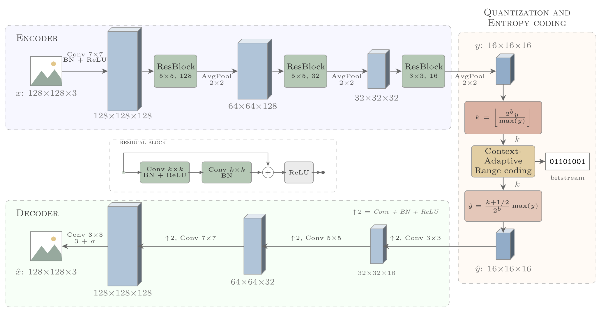
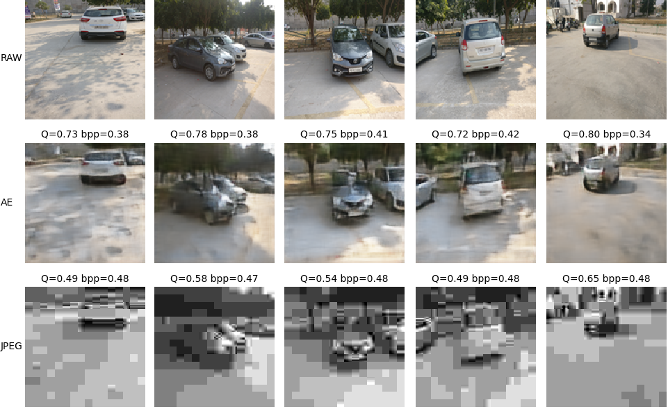
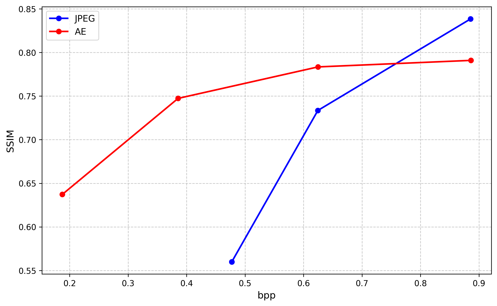

# Учебный проект, посвященный сжатию изображений при помощи автокодера

## Описание работы кодека
Данный учебный кодек сжимает изображения размером 128x128 при помощи автокодера, квантования и контекстно-адаптивного арифметического кодирования.
Ниже показана схема работы кодека:



На следующем примере показано сравнение эффективности работы данной модели, при b=2 (то есть когда коэффициенты скрытого вектора 
квантуются в четыре значения: 0, 1, 2 и 3). Здесь RAW помечена строка исходных изображений,
AE -- декодированные изображения для кодека на основе автокодера,
JPEG -- декодированные изображения для алгоритма JPEG в котором степень сжатия подобрана так, чтобы быть близкой к тому, что достигает AE.
Здесь Q -- это метрика качества изображения SSIM, а bpp -- это число бит на пиксель после сжатия (в исходном формате bpp=24).



На графике ниже показаны кривые скорость/искажение (rate-distortion) для AE и JPEG.



Как можно заметить, AE существенно выигрывает у JPEG по качеству на высоких степенях сжатия.  
По метрике BD-Rate средний выигрыш по SSIM при том же сжатии составляет 0.049, а при том же SSIM средний выигрыш по сжатию составляет 9.604\%

Значения bpp и Q для тестовых 20-ти изображений для b=2:<br>

| i | bpp | Q | JPEGbpp | JPEGQ |
|-----|------:|------:|--------:|------:|
| 0 | 0.384 | 0.733 | 0.476 | 0.494 |
| 1 | 0.378 | 0.778 | 0.466 | 0.580 |
| 2 | 0.407 | 0.751 | 0.479 | 0.544 |
| 3 | 0.420 | 0.716 | 0.476 | 0.493 |
| 4 | 0.338 | 0.804 | 0.477 | 0.650 |
| 5 | 0.385 | 0.798 | 0.479 | 0.655 |
| 6 | 0.381 | 0.742 | 0.490 | 0.541 |
| 7 | 0.410 | 0.748 | 0.500 | 0.585 |
| 8 | 0.370 | 0.730 | 0.477 | 0.555 |
| 9 | 0.410 | 0.735 | 0.495 | 0.565 |
| 10 | 0.382 | 0.726 | 0.462 | 0.573 |
| 11 | 0.395 | 0.784 | 0.468 | 0.565 |
| 12 | 0.359 | 0.778 | 0.475 | 0.581 |
| 13 | 0.413 | 0.715 | 0.490 | 0.557 |
| 14 | 0.383 | 0.722 | 0.481 | 0.553 |
| 15 | 0.378 | 0.697 | 0.474 | 0.503 |
| 16 | 0.398 | 0.688 | 0.483 | 0.477 |
| 17 | 0.373 | 0.764 | 0.469 | 0.561 |
| 18 | 0.388 | 0.797 | 0.461 | 0.590 |
| 19 | 0.355 | 0.743 | 0.466 | 0.575 |
| **Среднее** | **0.385** | **0.747** | **0.477** | **0.560** |

Таким образом, кодек AE обеспечивает средний выигрыш в 0.187 по метрике SSIM, при том что в среднем AE сжимает лучше на 19.3\%.

Что находится в папках:
- в папке ./train/ находятся изображения, которые были использованы для обучения сети
- в папке ./test/ находятся изображения для демонстрации результатов.
- в папке ./models/ находятся модели базового кодека AE для b=1,2,3,4

## Описание задания к лабораторной работе

Улучшить учебный кодек так, чтобы он:
- либо на том же bpp обеспечивал выигрыш по SSIM от 0.05 и выше относительно базового кодека AE;
- либо при том же уровне качества (среднем SSIM) обеспечивал от 10\% выигрыша по bpp относительно базового кодека по метрике BD-Rate 
в диапазоне работы AE кодека (bpp от 0.2 до 0.9).

Можно улучшать следующие модули:
- Арифметический кодер (учёт возможной памяти источника, оценка вероятностей); 
- Квантование (векторное квантование, использовать другую модель шума при обучении и т.д.);
- Нейронная сеть (количество слоёв, функции активации, связи между слоями и т.д.).

Требования к реализации:
- Результаты должны быть продемонстрированы на изображениях из папки ./test/ в виде таблички для 20 тестовых изображений и визуально для пяти первых изображений в том же стиле, как это сделано в базовой версии.
- При обучении должны использоваться только изображения из папки ./train/
- Построить график функции средний SSIM/bpp для 20ти тестовых изображений для b=1,2,3,4 для AE, JPEG и предложенного кодека.

На почту eabelyaev@itmo.ru прислать отчет в виде презентации в pdf формате, который включает в себя:
- ФИО студента, номер группы.
- Описание предложенной модификации и результаты.
- Ссылку на репозиторий с исходным кодом кодека и инструкцию по запуску.

## Воспроизведение результатов отчёта

Предложенный кодек подбирает для каждого канала пространственного соседа и канал-подсказку. На 20 тестовых изображениях он дал **−15,42% BD-Rate** относительно базового AE на общей части кривых в диапазоне 0,2–0,9 bpp.

Запуск из корня проекта на Linux с Python 3.11:

```sh
python3.11 -m venv .venv
.venv/bin/python -m pip install -r requirements-benchmark.txt
.venv/bin/python benchmark_context_map.py --output results/context-map
```

Скрипт использует готовые модели из `models/` и заново вычисляет латенты для всех четырёх значений `b`. Контекст и начальные частоты подбираются на `train/`. Каждое пятое изображение из `train/` отложено для проверки. На первых 20 файлах из `test/` в порядке номеров измеряются битрейт и SSIM. Для каждого потока проверяется точное восстановление квантованных признаков.

Скрипт записывает:

- `context-maps.json` и `learned-both-prior-b*.npy` с параметрами кодирования.
- `roundtrip-validation.csv`, `test.csv`, `summary.csv` и `bd-rate.txt` с метриками.
- `rd-performance.png` и `comparison-b2.png` с кривыми и визуальным сравнением первых пяти изображений.

Как и в исходном кодеке, bpp для AE считается по размеру арифметического потока. Масштаб деквантования и общие таблицы частот в этот размер не входят. JPEG сравнивается при ближайшем доступном битрейте к базовому AE.
